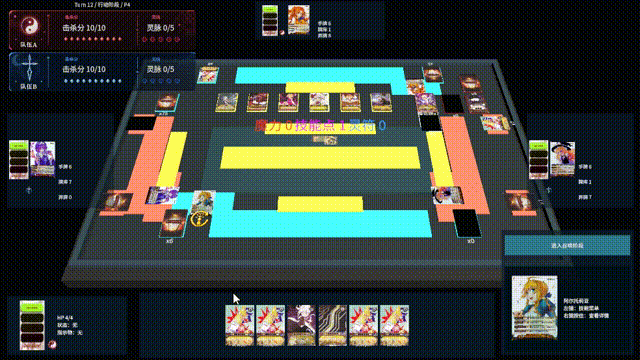
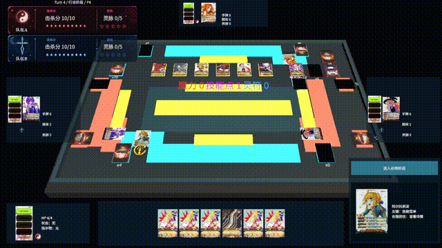

# Crescent Wreath / 新月花冠

《新月花冠》是一款使用 Unity 开发的四人固定 2V2 联机卡牌游戏原型。项目采用服务器权威架构，通过 WebSocket 为每名玩家生成独立的可见性投影。

## 当前功能

- 四人固定 2V2 局域网联机
- 房间列表、阵营选择、准备流程与服务器座次分配
- 服务器权威的 RuleCore 与结构化追踪日志
- 根据玩家身份隔离信息的 WebSocket 状态投影
- 3D 战场与卡牌详情查看
- 角色、宝具、异变、`ResponseWindow` 与 `InputContext` 系统
- 卡牌移动动画、VFX/SFX 接入与角色技能演出

## 功能展示

### 技能与伤害演出



### 宝具购买与牌库循环



## 架构

`RuleCore -> ServerGameSession -> 玩家可见性投影 -> Unity Client`

- `RuleCore/`：确定性的游戏状态与规则裁定
- `Server/`：局域网房间、权威对局、WebSocket Host 与状态投影
- `UnityClient/CrescentWreathClinet/`：Unity 客户端与表现层
- `docs/`：规则书、概要设计与详细设计文档

## 开发状态

当前处于 LAN Alpha / 作品集原型阶段。

Steam、公网匹配、账号、观战和断线重连不在当前开发范围内。

## 本地运行

- Unity Editor：`6000.3.11f1`
- 启动服务器：运行 `Server/CrescentWreath.ServerPrototype.Host/run-host.bat`
- 默认 Lobby 地址：`ws://127.0.0.1:18080/ws?mode=lobby`
- 局域网玩家可在连接界面中，将 `127.0.0.1` 替换为服务器所在设备的局域网或虚拟局域网 IPv4 地址

用于开发调试的旧版直连入口仍然保留：

```text
/ws?viewerPlayerNumericId=1
/ws?viewerPlayerNumericId=2
/ws?viewerPlayerNumericId=3
/ws?viewerPlayerNumericId=4
```

## 第三方素材

项目使用了部分第三方美术、VFX、SFX、字体、UI 素材和桌游参考资料。本仓库不声明这些内容由项目开发者原创。

对于许可证不允许公开再分发的商业 VFX 与 SFX，本公开仓库仅保留接入代码和配置，不包含原始素材。需要相关演出时，请在本地导入合法授权的素材，并通过 Unity Editor 重新生成效果目录。

除非具体文件或目录另有明确声明，本仓库不会自动授予项目自有游戏内容的开源许可。仓库中包含的第三方程序包继续遵循各自的许可证条款。
